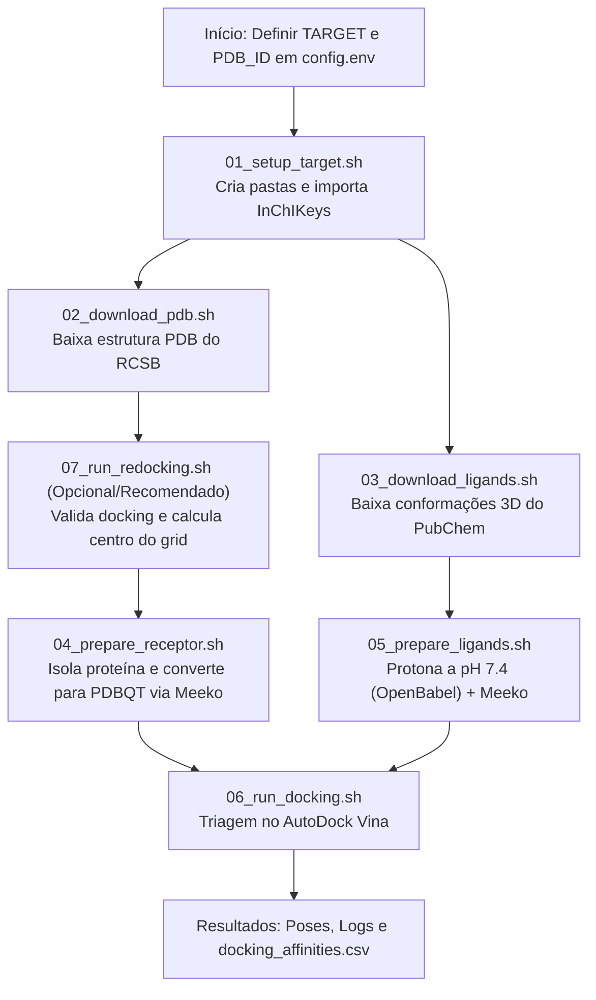

# Pipeline Automatizado de Docking Molecular

Pipeline em Shell Script e Python para triagem virtual de fármacos (*virtual screening*), preparação de macromoléculas e validação por redocking utilizando **AutoDock Vina**, **Meeko**, **OpenBabel** e **RDKit**.

O fluxo foi desenhado para ser totalmente flexível, permitindo a análise de múltiplos alvos terapêuticos sem caminhos codificados de forma rígida (*hardcoded*).

---

## 📌 Sumário
1. [Visão Geral e Fluxo de Trabalho](#-visão-geral-e-fluxo-de-trabalho)
2. [Estrutura do Repositório](#-estrutura-do-repositório)
3. [Instalação e Pré-requisitos](#-instalação-e-pré-requisitos)
4. [Configuração do Estudo](#-configuração-do-estudo)
5. [Como Executar](#-como-executar)
   - [Opção 1: Pipeline Completo (1 Comando)](#opção-1-pipeline-completo-em-1-comando-recomendado)
   - [Opção 2: Execução Modular (Passo a Passo)](#opção-2-execução-modular-passo-a-passo)
6. [Gerenciamento de Ligantes (Hub de InChIKeys)](#-gerenciamento-de-ligantes-hub-de-inchikeys)
7. [Validação por Redocking e Cálculo de RMSD](#-validação-por-redocking-e-cálculo-de-rmsd)
8. [Localização dos Resultados](#-localização-dos-resultados)
9. [Solução de Problemas (Troubleshooting)](#-solução-de-problemas-troubleshooting)

---

## 🔄 Visão Geral e Fluxo de Trabalho

O pipeline cobre desde a aquisição da estrutura cristalográfica até a triagem de ligantes e geração de relatórios de afinidade:



---

## 📂 Estrutura do Repositório

```text
docking_alz/
├── README.md                          # Documentação geral do projeto
├── configs/                           # Arquivos de configuração individualizados por alvo
│   ├── template.env                   # Modelo para criação de novos alvos
│   ├── AKT1.env                       # Configuração para AKT1 (3O96 / IQO)
│   ├── JAK2.env                       # Configuração para JAK2 (6WTQ / U8J)
│   └── CCND1.env                      # Configuração para CCND1 (2W96 / Z36)
├── scripts/                           # Conjunto de scripts do pipeline
│   ├── config.env                     # Arquivo de configuração padrão/ativo
│   ├── load_config.sh                 # Carregador dinâmico de configurações (.env / args)
│   ├── 01_setup_target.sh             # Cria pastas do alvo e importa InChIKeys
│   ├── 02_download_pdb.sh             # Download da estrutura cristalográfica (RCSB)
│   ├── 03_download_ligands.sh         # Download de estruturas 3D do PubChem
│   ├── 04_prepare_receptor.sh         # Limpeza do receptor (sem cofator) e conversão para PDBQT
│   ├── 04b_prepare_receptor_cofactor.sh # Preparação paralela do receptor COM cofatores/íons
│   ├── 05_prepare_ligands.sh          # Protonação fisiológica a pH 7.4 e geração de PDBQT
│   ├── 06_run_docking.sh              # Execução da triagem molecular no AutoDock Vina
│   ├── 07_run_redocking.sh            # Extração de ligante nativo, docking e cálculo de RMSD
│   ├── 07b_setup_blind_box.sh         # Configuração automática de Bounding Box para Blind Docking
│   ├── build_cofactor_templates.py    # Gerador de templates químicos JSON (Meeko v0.6+)
│   ├── sanitize_charged_sdf.py        # Módulo de correção de valência em éteres (OpenBabel/RDKit)
│   └── run_all.sh                     # Orquestrador do pipeline completo
└── targets/                           # Diretório de dados por alvo
    └── <TARGET>/                      # Ex: AKT1, JAK2, CCND1
        ├── config.txt                 # Arquivo de configuração do AutoDock Vina
        ├── receptor/
        │   ├── raw/                   # Estrutura bruta (.pdb) baixada do RCSB
        │   └── prepared/              # Proteína limpa (.pdb) e receptor pronto (.pdbqt)
        ├── ligands/
        │   ├── inchikeys.txt          # Lista de InChIKeys atribuídos a este alvo
        │   ├── raw/                   # Estruturas 3D (.sdf) e protonadas (.sdf)
        │   └── prepared/              # Ligantes prontos com cargas parciais (.pdbqt)
        ├── redocking/
        │   ├── crystallographic/      # Ligante nativo isolado (.pdb / .sdf)
        │   ├── prepared/              # Ligante nativo de referência (.pdbqt / .sdf)
        │   └── results/               # Melhor pose redocada (.pdbqt / .sdf) e logs
        └── results/
            ├── poses/                 # Poses geradas para cada ligante (*_out.pdbqt)
            ├── logs/                  # Logs detalhados de energia e afinidade (*.log)
            └── summary/               # Tabela consolidada (docking_affinities.csv)
```

---

## ⚙️ Instalação e Pré-requisitos

O pipeline foi projetado para rodar no ambiente **Linux / Ubuntu (WSL no Windows)** com o gerenciador de pacotes **Conda/Miniconda**.

### 1. Criar e Ativar o Ambiente Conda
```bash
conda create -n docking_vina -c conda-forge python=3.10 meeko rdkit openbabel vina prody -y
conda activate docking_vina
```

### 2. ChimeraX (Recomendado para manipulação headless)
Usado para remover solventes e extrair ligantes nativos automaticamente:
```bash
# Baixe e instale o pacote .deb do UCSF ChimeraX para Ubuntu
sudo dpkg -i ucsf-chimerax_*.deb
```
*(Caso não possua o ChimeraX instalado, você pode preparar o arquivo `protein_clean.pdb` manualmente no Discovery Studio).*

### 3. Permissões de Execução
No terminal do Ubuntu:
```bash
cd ~/docking_alz
chmod +x scripts/*.sh scripts/*.py
```

---

## 📝 Configuração do Estudo e Múltiplos Alvos

Você pode gerenciar múltiplos alvos de forma organizada utilizando a pasta `configs/`. Cada receptor possui seu próprio arquivo `.env` contendo seus parâmetros específicos:

### 1. Criando um Novo Alvo
Para configurar um novo alvo (ex: `CCND1` ou `EGFR`), basta duplicar o modelo `template.env`:

```bash
cp configs/template.env configs/EGFR.env
nano configs/EGFR.env
```

Conteúdo de um arquivo de configuração (ex: `configs/CCND1.env`):
```bash
# Identificadores do Alvo
TARGET="CCND1"                 # Nome da pasta/alvo em targets/
PDB_ID="2W96"                  # Código de 4 caracteres no RCSB PDB
NATIVE_LIG="Z36"               # Código de 3 letras do ligante nativo no cristal
COFACTOR_RES=""                # Cofatores separados por vírgula (ex: "GNP,MG" ou "HEM"). Vazio "" = sem cofator.

# Caminho da pasta central de InChIKeys
HUB_INCHIKEYS_DIR="/mnt/c/Users/gui-a/OneDrive/Desktop/TCC/Docking/hub_inchikeys"

# Dimensões da Caixa de Grid (Angstroms)
SIZE_X="22.0"
SIZE_Y="22.0"
SIZE_Z="22.0"

# Parâmetros de Busca do AutoDock Vina
EXHAUSTIVENESS="8"             # Exaustividade da busca conformacional (padrão: 8)
NUM_MODES="9"                  # Número máximo de poses geradas por ligante
ENERGY_RANGE="3"               # Janela máxima de energia relativa (kcal/mol)

# Modo Blind Docking (Docking Cego na proteína inteira)
# Ativado automaticamente se BLIND_DOCKING="true" ou se NATIVE_LIG="" estiver vazio
BLIND_DOCKING="false"
BLIND_PADDING="6.0"            # Margem extra (Å) somada às dimensões (max - min) da proteína
BLIND_EXHAUSTIVENESS="16"      # Exaustividade mínima recomendada para o volume total da proteína
```

> [!TIP]
> O arquivo `scripts/config.env` continua existindo e funciona como configuração padrão quando nenhum argumento é passado.

---

## 🚀 Como Executar

### Opção 1: Pipeline Completo em 1 Comando (Recomendado)

Você pode invocar qualquer alvo configurado de várias formas práticas:

#### A) Pelo nome do alvo (reconhece automaticamente `configs/<ALVO>.env`):
```bash
./scripts/run_all.sh CCND1
./scripts/run_all.sh JAK2
./scripts/run_all.sh AKT1
```

#### B) Pelo caminho do arquivo `.env`:
```bash
./scripts/run_all.sh configs/CCND1.env
# Ou com a flag explícita:
./scripts/run_all.sh --config configs/JAK2.env
```

#### C) Passando argumentos manuais diretamente:
```bash
./scripts/run_all.sh CCND1 2W96 Z36
```

#### D) Usando o arquivo padrão (`scripts/config.env`):
```bash
./scripts/run_all.sh
```

#### E) Execução em lote (Batch screening de múltiplos alvos):
Para rodar todos os alvos configurados em sequência:
```bash
for cfg in configs/*.env; do
    [ "$cfg" = "configs/template.env" ] && continue
    echo "=== Executando docking para $cfg ==="
    ./scripts/run_all.sh "$cfg"
done
```

---

### Opção 2: Execução Modular (Passo a Passo)

Se preferir inspecionar os arquivos gerados em cada etapa:

```bash
cd ~/docking_alz

# 1. Configurar pastas e importar InChIKeys do hub
./scripts/01_setup_target.sh

# 2. Baixar a estrutura do PDB
./scripts/02_download_pdb.sh

# 3. Preparar o receptor com Meeko (gera receptor.pdbqt)
# Opção A: Sem cofator
./scripts/04_prepare_receptor.sh
# Opção B: Com cofatores (caso COFACTOR_RES esteja definido no .env ou passado por argumento)
./scripts/04b_prepare_receptor_cofactor.sh AKT1 3O96 "GNP,MG"

# 4. Definir a Grid Box (Sítio-Específico vs. Blind Docking)
# Opção A: Redocking (valida RMSD e calcula o centro da cavidade ativa no config.txt)
./scripts/07_run_redocking.sh
# Opção B: Blind Docking (calcula Bounding Box da proteína inteira + 6.0 Å padding e exhaustiveness 16)
./scripts/07b_setup_blind_box.sh AKT1

# 5. Baixar as estruturas 3D dos ligantes no PubChem
./scripts/03_download_ligands.sh

# 6. Protonar os ligantes a pH 7.4 (OpenBabel) e gerar PDBQTs (Meeko)
./scripts/05_prepare_ligands.sh

# 7. Executar a triagem de docking no AutoDock Vina
./scripts/06_run_docking.sh
```

---

## 🔑 Gerenciamento de Ligantes (Hub de InChIKeys)

Para não precisar digitar ou copiar listas de ligantes manualmente, utilize a pasta central:
* **No Windows:** `C:\Users\gui-a\OneDrive\Desktop\TCC\Docking\hub_inchikeys\`
* **No Linux:** `/mnt/c/Users/gui-a/OneDrive/Desktop/TCC/Docking/hub_inchikeys/`

Basta salvar o arquivo com o nome do alvo (ex: `JAK2.txt`, `CCND1.txt`). O pipeline:
1. Detecta o arquivo automaticamente.
2. Remove quebras de linha do Windows (`\r`).
3. Copia para `targets/${TARGET}/ligands/inchikeys.txt`.
4. Baixa todas as conformações 3D em lote via API REST do PubChem.

---

## 🎯 Validação por Redocking e Cálculo de RMSD

O redocking do ligante co-cristalizado valida a metodologia de acoplamento molecular:

1. **Cálculo Automático do Centro do Grid:**
   O script `07_run_redocking.sh` calcula o centróide matemático dos átomos pesados do ligante nativo e preenche os campos `center_x`, `center_y` e `center_z` em `targets/${TARGET}/config.txt` automaticamente.
2. **Cálculo de RMSD no Terminal:**
   Ao final da execução, o script compara a pose original com a melhor pose do redocking via RDKit:
   - **RMSD $\le$ 2.0 Å:** Protocolo de docking validado com sucesso.
   - **RMSD $>$ 2.0 Å:** Sugere revisão das dimensões do grid ou da conformação da proteína.
3. **Inspeção Visual no Discovery Studio:**
   - Abra `targets/${TARGET}/redocking/prepared/ligante_original_preparado.sdf` &rarr; `Structure > RMSD > Set reference`.
   - Abra `targets/${TARGET}/redocking/results/native_ligand_redocked.sdf` &rarr; `Structure > Superimpose > Molecular Overlay`.
   - Clique em `Structure > RMSD > Heavy Atoms`.

---

## 📊 Localização dos Resultados

Todos os arquivos gerados após o docking ficam organizados em `targets/${TARGET}/`:

* **Tabela de Afinidades (CSV):**
  `targets/${TARGET}/results/summary/docking_affinities.csv`
  *(Contém os nomes de cada composto, as melhores afinidades em kcal/mol e caminhos dos logs).*
* **Poses 3D dos Ligantes Acoplados:**
  `targets/${TARGET}/results/poses/*_out.pdbqt`
* **Logs do AutoDock Vina:**
  `targets/${TARGET}/results/logs/*.log`

---

## 🛠️ Solução de Problemas (Troubleshooting)

### 1. `[RDKit] ERROR: Explicit valence for atom O, 2, is greater than permitted`
- **Causa:** O OpenBabel ao rodar com `-p 7.4` em anéis conjugados ou éteres atribui acidentalmente uma carga formal `-1` a um oxigênio que já possui 2 ligações covalentes simples.
- **Solução implementada:** O script `05_prepare_ligands.sh` integra o módulo `sanitize_charged_sdf.py`, que neutraliza automaticamente essa anomalia nos éteres enquanto **mantém 100% preservadas as protonações fisiológicas a pH 7.4** nos fenóis, carboxilatos e aminas.

### 2. `Template matching failed for: ['A:849', ...]` e `Residues with alternate location`
- **Causa:** Estruturas cristalográficas com resíduos superficiais sem densidade de cadeia lateral (`REMARK 470`) ou átomos duplicados (*altlocs* A/B).
- **Solução implementada:** O script `04_prepare_receptor.sh` passa nativamente as opções `--default_altloc A --delete_bad_res` para o Meeko, permitindo gerar o receptor rígido sem interrupções.

### 3. `Receptor was prepared, but no files were written`
- **Causa:** No Meeko $\ge 0.5$, a flag `-o` define apenas o prefixo e não salva arquivos se a flag de escrita não for especificada.
- **Solução implementada:** O script utiliza `-p` (`--write_pdbqt`), garantindo a escrita do arquivo `receptor.pdbqt`.
